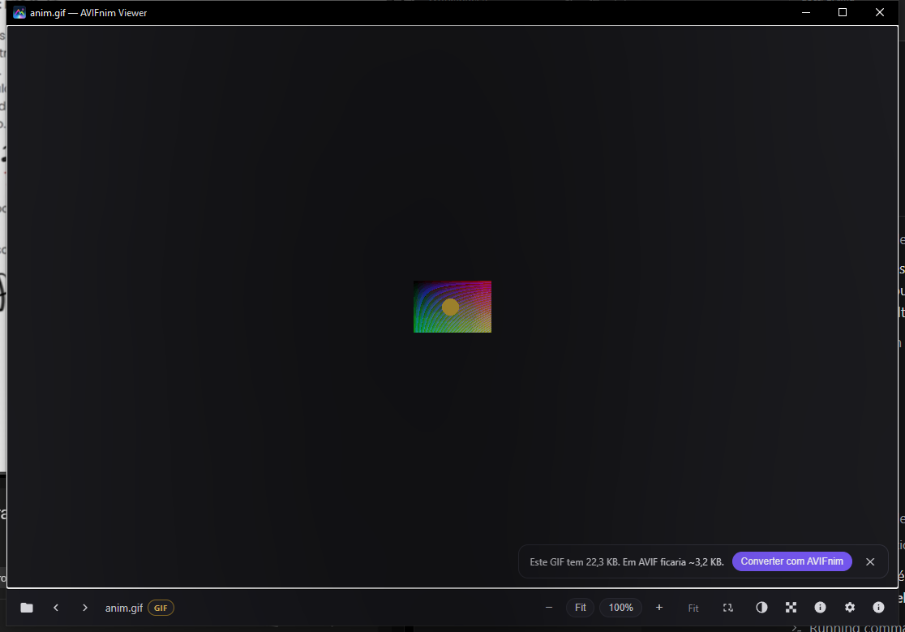
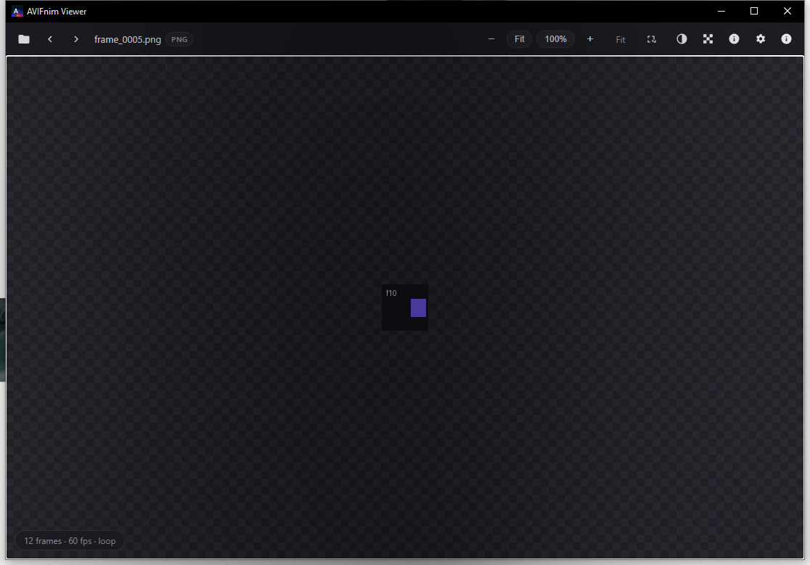
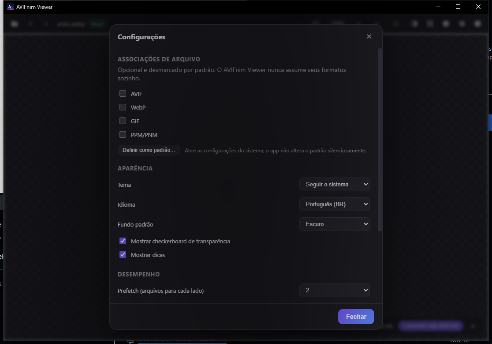
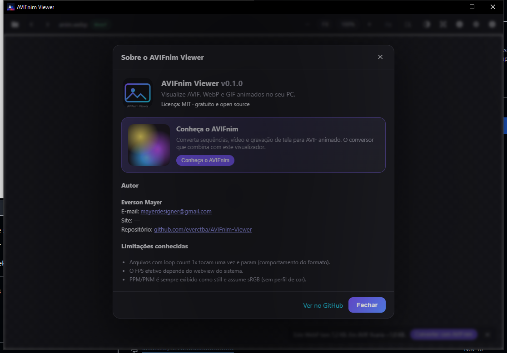
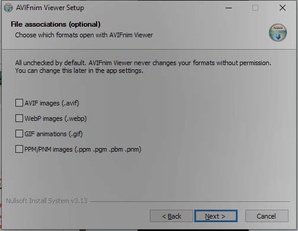
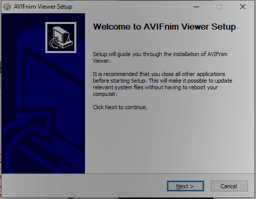
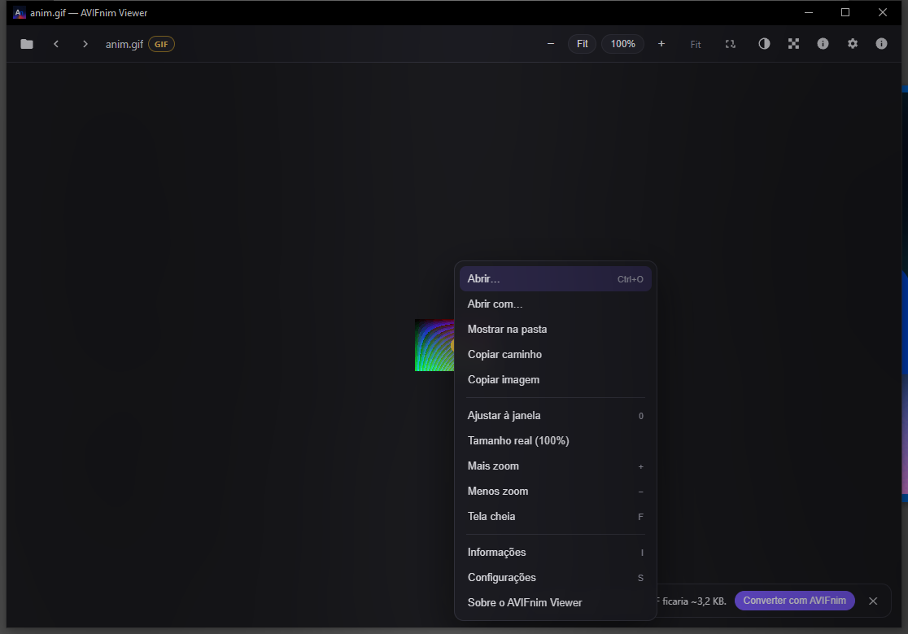

# AVIFnim Viewer

[](https://github.com/everctba/AVIFnim-Viewer/releases/latest)
[](https://github.com/everctba/AVIFnim-Viewer/actions/workflows/ci.yml)
[](LICENSE)

Visualizador **gratuito e open source (MIT)** de imagens animadas **AVIF, WebP e GIF** e de
stills/sequências **PPM/PNM** para Windows, macOS e Linux — construído com **Tauri 2 + Rust**.

## Download

| Plataforma | Artefato |
|---|---|
| **Windows 10/11 x64** | [Instalador NSIS (v0.1.1)](https://github.com/everctba/AVIFnim-Viewer/releases/download/v0.1.1/AVIFnim.Viewer_0.1.1_x64-setup.exe) |
| **Linux x64** | [`.deb` (v0.1.1)](https://github.com/everctba/AVIFnim-Viewer/releases/download/v0.1.1/AVIFnim.Viewer_0.1.1_amd64.deb) — Ubuntu 24.04+/Mint, WebKitGTK 4.1 |
| **macOS 13+** | [`.dmg` universal (v0.1.1)](https://github.com/everctba/AVIFnim-Viewer/releases/download/v0.1.1/AVIFnim.Viewer_0.1.1_universal.dmg) — Intel + Apple Silicon, gerado no CI (`macos-latest`) |

Página de releases com todos os arquivos: https://github.com/everctba/AVIFnim-Viewer/releases/latest
Sem assinatura de código / notarização nesta versão (decisões pendentes).

Os instaladores também ficam na pasta local [`dist/`](dist/README.md) após o build/coleta
(`scripts/collect-dist.ps1`); os binários não são versionados no git, mas os hashes em
[`dist/SHA256SUMS.txt`](dist/SHA256SUMS.txt) conferem com os assets da release.

**Instalação:**
- Windows: execute o instalador NSIS (SmartScreen pode pedir confirmação).
- Linux: `sudo apt install ./AVIFnim.Viewer_0.1.1_amd64.deb`
- macOS: abra o `.dmg`, arraste o app para Applications; sem notarização, use "Abrir" no menu de contexto na primeira vez.

> **Por que existe:** os visualizadores nativos dos sistemas costumam abrir AVIF, mas **não
> animam** (no Windows, o Fotos mostra só o primeiro frame); e PPM/PNM não é suportado por
> webview nenhum. O AVIFnim Viewer resolve isso sendo leve, focado e respeitoso.

**Tagline:** “Visualize AVIF, WebP e GIF animados no seu PC.”

## Screenshots

| Visualizador (GIF + banner) | Sequência PNG a 60 fps |
|---|---|
|  |  |

| Configurações | Sobre |
|---|---|
|  |  |

| Instalador — associações opt-in (desmarcadas) | Instalador — boas-vindas |
|---|---|
|  |  |

| Menu de contexto próprio (botão direito) |
|---|
|  |


---

## Recursos

- Abre e toca em loop **AVIF animado/still, WebP animado/still e GIF** usando o webview do sistema.
- Decodifica **PPM/PNM (P1–P6, 8/16-bit)** em Rust puro (crate `image`, sem FFmpeg/GPL) e exibe como PNG.
- **Navegação** próximo/anterior na pasta com ordenação natural (`frame_2` antes de `frame_10`) e setas do teclado.
- **Prefetch bidirecional** de bytes (janela ±N, LRU, teto configurável de memória, default 128 MB).
- **Controles de visualização**: zoom, pan, fit, 100%, fullscreen, checkerboard de transparência e fundos claro/escuro/cinza.
- **Menu de contexto próprio** (botão direito sobre a imagem): abrir, abrir com… (Windows), mostrar na pasta, copiar caminho/imagem, zoom, fit/100%, tela cheia, informações, configurações e sobre — sem o menu nativo do webview.
- **Duplo clique** alterna entre Fit e 100%.
- **Sequências PNG/JPG (G7)**: detecção automática pelo nome do arquivo e reprodução em loop a **30 ou 60 fps**.
- **Associações de arquivo opt-in**, desmarcadas por padrão; o app nunca “sequestra” formatos.
- **Funil discreto** para o AVIFnim pago: modal único após a 5ª visualização + banner contextual em GIF/WebP.
- **PT-BR e EN-US**, tema claro/escuro/sistema, atalhos de teclado e acessibilidade (foco visível, ARIA, contraste AA).
- **Sem telemetria**, sem contas, sem nuvem.

## Formatos suportados

| Formato | Animação | Alpha | Loop | Exibição |
|---|---|---|---|---|
| AVIF | sim (nativo do webview) | sim | sim | `` |
| WebP | sim | sim | sim | `` |
| GIF | sim | 1-bit | sim | `` |
| PPM/PNM (P1–P6) | não (still) | não | — | Rust → PNG |
| PNG/JPG (sequência G7) | frames em loop | sim | configurável | `` |

## Limitações conhecidas

- **Loop count 1x**: arquivos com loop 1x tocam uma vez e param (comportamento do formato).
- **FPS efetivo** depende do webview do sistema (WKWebView/WebKitGTK podem limitar).
- **PPM/PNM** é sempre still e assume sRGB (o formato não carrega perfil de cor).
- **Sem pause/seek/frame step** na v1 (loop-only) — decoder próprio fica para o v2.
- Não abre vídeo, HEIC, JXL, RAW, PSD.

## Benchmark (Windows 10, release)

| Métrica | Resultado |
|---|---|
| Startup (janela criada) | 30–78 ms (avg 60 ms) |
| Abrir AVIF 5,38 MB (2400×1350) | 258 ms até o primeiro paint |
| Abrir AVIF 1080p 3,44 MB | 180 ms |
| Sequência PNG 12 frames | 56,4 fps medidos |

Reprodução: `scripts\bench-startup.ps1` e modo `AVIFNIM_BENCH=1` (detalhes em `docs/QA.md`).

## Desenvolvimento

### Pré-requisitos (Windows)

- **Rust** 1.77+ (toolchain `x86_64-pc-windows-msvc`)
- **Visual Studio Build Tools** com “Desktop development with C++” (MSVC + Windows SDK)
- **Node.js 18+** (só para o CLI do Tauri)
- **WebView2 Runtime** (já presente no Windows 10/11 atualizado)

> O build precisa do ambiente do MSVC. Use o script `scripts/build.ps1` (ou chame
> `vcvars64.bat` antes de rodar `cargo`/`tauri`). Veja [docs/BUILD.md](docs/BUILD.md).

```bash
npm install                 # instala o CLI do Tauri
npm run dev                 # app em modo desenvolvimento
npm run build               # instalador (NSIS) em src-tauri/target/release/bundle
cd src-tauri && cargo test  # testes unitários (PNM, cache, ordenação natural)
```

### Estrutura

```
src/                 # UI (HTML/CSS/JS puro, sem bundler)
src-tauri/           # backend Rust (Tauri 2)
  src/lib.rs         # comandos: abrir, carregar, prefetch, settings, associações, funil
  src/pnm.rs         # decode PPM/PNM -> PNG (com caps de segurança)
  src/cache.rs       # cache LRU de bytes para prefetch
  src/config.rs      # settings.json no app data
  src/assoc.rs       # associações opt-in via registro do Windows
tests/assets/        # amostras para QA (AVIF/WebP/GIF/PPM/sequência)
docs/                # documentação de build e QA
```

## Roadmap

| Versão | Entrega |
|---|---|
| **v1.0 (MVP)** | Windows (instalador NSIS), macOS 13+ (DMG), Linux x64 (.deb) |
| v1.1 | Quick Look (macOS), metadados avançados (frames/duração/FPS), Flatpak/Microsoft Store |
| v2 (backlog) | Decoder/player próprio (pause/seek/frame step) |

## Licença

MIT — veja [LICENSE](LICENSE). Avisos de terceiros em [THIRD_PARTY_NOTICES.md](THIRD_PARTY_NOTICES.md).
O **AVIFnim** (conversor pago) é um produto separado; este repositório não compartilha código com ele.
